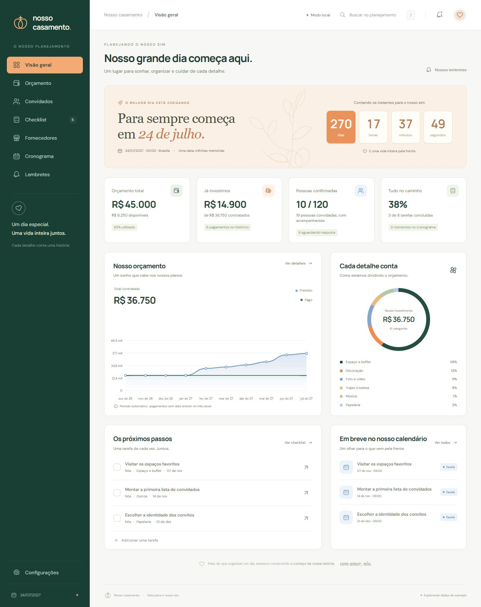

# Nosso Casamento 💍

**Cada detalhe, mais perto do sim.** Um painel para organizar o casamento de **24 de julho de 2027**, com contagem regressiva em tempo real, orçamento, convidados, checklist e fornecedores.

O visual combina **laranja, branco, azul e verde**, inspirado nas referências de planejamento de casamento e dashboard financeiro. A interface está em português do Brasil e se adapta a computador, tablet e celular.



<details>
<summary>Ver a versão para celular</summary>


</details>

## Funcionalidades

### Aplicativo Android

**[Baixar o APK de demonstração (4,16 MB)](https://github.com/PedroHda/NossoCasamento/raw/refs/heads/master/apk/NossoCasamento-v1.0.0-demo.apk)** · [SHA-256](apk/NossoCasamento-v1.0.0-demo.apk.sha256)

O projeto inclui uma versão Android com **Capacitor 8**, nome **Nosso Casamento**, ícone de alianças, tela inicial nas cores do projeto e funcionamento offline. A contagem regressiva e todos os cadastros estão no APK.

Para gerar um APK de demonstração assinado para instalação direta:

```bash
npm ci
npm run android:apk
```

A saída é `releases/NossoCasamento-v1.0.0-demo.apk`, acompanhada do SHA-256. A compilação requer **JDK 21**, **SDK Android 36** e internet na primeira execução. Defina `JAVA_HOME` e `ANDROID_HOME` caso as ferramentas não sejam detectadas.

Veja o [guia Android](docs/android.md) para instalar, recompilar e entender o armazenamento e a assinatura do APK.

| Área              | O que você pode fazer                                                                                                                                |
| ----------------- | ---------------------------------------------------------------------------------------------------------------------------------------------------- |
| **Visão geral**   | Consultar contagem regressiva, orçamento, valores pagos, confirmações, progresso das tarefas, gráficos e próximos passos.                            |
| **Orçamento**     | Cadastrar, editar e excluir despesas; definir orçamento; registrar pagamentos parciais; acompanhar saldo e vencimentos; buscar e filtrar por status. |
| **Convidados**    | Organizar nomes por grupo, registrar acompanhantes e atualizar a confirmação de cada convite.                                                        |
| **Checklist**     | Criar tarefas com categoria e prazo, concluir ou reabrir tarefas e filtrar pendentes e concluídas.                                                   |
| **Fornecedores**  | Guardar nome, categoria, contato, observações e etapa da contratação.                                                                                |
| **Configurações** | Personalizar nome do casal, local, orçamento e meta de convidados; exportar/importar backups e começar um planejamento vazio.                        |
| **Busca global**  | Encontrar registros pelo botão de busca ou pelo atalho `/`.                                                                                          |

Os cadastros têm validação, confirmação antes de excluir e mensagens de retorno. A interface inclui navegação por teclado, foco visível, janelas com `<dialog>`, link para pular ao conteúdo e respeito à preferência de movimento reduzido.

## Executar localmente

### Pré-requisitos

- **Node.js 22.12 ou superior** e npm.
- Navegador moderno com JavaScript, `localStorage`, `<dialog>` e `crypto.randomUUID()`.

```bash
git clone https://github.com/PedroHda/NossoCasamento.git
cd NossoCasamento
npm ci
npm run dev
```

Abra o endereço indicado pelo Vite, normalmente **http://127.0.0.1:5173/**. Se a porta estiver ocupada, o terminal poderá indicar outra.

Não é necessário configurar banco de dados, chave de API, `.env` ou conta de usuário.

### Primeiro acesso

1. Explore o painel com os **dados de exemplo**. Nomes, despesas e fornecedores iniciais são fictícios.
2. Abra **Configurações** e personalize nome do casal, orçamento, meta de convidados e local.
3. Clique em **Começar do zero** para remover os exemplos. Suas preferências são mantidas.
4. Adicione suas despesas, convidados, tarefas e fornecedores.
5. Exporte backups regularmente.

O indicador **“Explorando dados de exemplo”** permanece visível até você começar do zero. Editar um exemplo não remove esse indicador automaticamente.

## Contagem regressiva

O instante de referência é **24/07/2027 às 00:00:00, no horário de Brasília (UTC−03:00)**:

```js
export const WEDDING_DATE = "2027-07-24";
export const WEDDING_TIME = "2027-07-24T00:00:00-03:00";
```

A atualização acontece a cada segundo. O painel mostra dias completos, horas, minutos e segundos. Ao chegar à data, os números ficam em zero e aparece **“O nosso grande dia chegou!”**. A contagem nunca fica negativa e usa o mesmo instante em qualquer fuso horário. O relógio do dispositivo precisa estar correto.

A data está fixa para este projeto. Para adaptar a outro casamento, altere as constantes em `src/model.js`, os textos da data e o período do gráfico em `src/main.js`, além dos testes correspondentes. A tela de configurações permite consultar a data, mas não alterá-la.

## Regras dos indicadores

### Orçamento

- **Total contratado:** soma do valor total das despesas.
- **Já pago:** soma dos pagamentos registrados.
- **Falta pagar:** contratado menos pago.
- **Disponível:** orçamento menos contratado; um saldo negativo sinaliza excesso.
- **Pago:** pagamento igual ao total. **Parcial:** pagamento maior que zero e menor que o total. **Pendente:** nenhum pagamento registrado.
- Pagamentos não podem ser negativos nem ultrapassar o valor da despesa.
- Totais financeiros são calculados em centavos para evitar erros comuns de ponto flutuante.

O gráfico azul mostra **compromissos acumulados por mês de vencimento**, de outubro de 2026 a julho de 2027. Despesas sem vencimento entram em julho de 2027. É uma visualização do planejamento, não um extrato ou histórico de pagamentos. Despesas após julho de 2027 continuam nos totais e na tabela, mas ficam fora do período do gráfico.

A rosca considera todas as categorias com despesas e mostra as quatro maiores na legenda. Consulte todos os registros na tabela de orçamento.

### Convidados e tarefas

- Cada convite representa o convidado principal **mais os acompanhantes**.
- A confirmação se aplica a todas as pessoas daquele convite.
- A meta de convidados é independente da quantidade cadastrada.
- Confirmações são registradas manualmente; o aplicativo não envia convites nem coleta RSVP público.
- O progresso é a porcentagem de tarefas concluídas, arredondada para um inteiro.
- Tarefas pendentes com prazo anterior à data atual em Brasília são sinalizadas como atrasadas.

## Dados, privacidade e backups

O planejamento é salvo no **`localStorage` do navegador**, na chave `nosso-casamento:v1`. Ele persiste ao recarregar e reabrir a página, desde que o navegador mantenha esse armazenamento.

**Não há backend, login ou sincronização automática entre dispositivos.** O GitHub recebe o código do projeto; os cadastros pessoais não são enviados ao repositório pelo aplicativo. Abas da mesma origem recebem as atualizações salvas por outra aba.

O armazenamento é específico do navegador, perfil e origem — protocolo, domínio e porta. Abrir o aplicativo em outra porta ou outro endereço cria um espaço separado. Limpar os dados do site, usar navegação privada ou bloquear o armazenamento pode apagar dados ou impedir a gravação.

### Exportar e importar

1. Em **Configurações → Exportar backup**, baixe um arquivo como `nosso-casamento-backup-2026-10-24.json`.
2. Guarde o arquivo; ele contém preferências e todos os cadastros e **não é criptografado**.
3. Para restaurar, use **Importar backup** e selecione um JSON exportado pelo aplicativo, de até **5 MB**.
4. Confira as quantidades de registros e confirme a substituição.

A importação **substitui** os dados atuais, sem mesclar registros. Exporte o planejamento atual antes, se quiser preservá-lo. O aplicativo valida versão, listas, valores, datas, status e identificadores antes de salvar. Cada lista aceita até 10.000 registros. Texto de usuário é escapado antes da exibição no HTML.

Se houver erro de armazenamento, a interface avisa. Mantenha backups antes de limpar dados ou trocar de navegador/dispositivo.

## Tecnologias e estrutura

- **JavaScript com módulos ES**, sem framework de interface.
- **Vite 7** para desenvolvimento e build.
- **HTML e CSS responsivo**, com Grid, Flexbox e variáveis de cores.
- **SVG** para ícones, marca, ilustração botânica e gráfico de linha.
- **CSS `conic-gradient`** para a rosca de categorias.
- **`Intl`** para datas, moeda brasileira e fuso horário.
- **Node.js Test Runner**, sem dependências adicionais de teste.
- **DM Sans e Manrope**, incorporadas localmente pelo Fontsource para funcionar offline.
- **Capacitor 8**, para empacotar a interface como aplicativo Android.

```text
NossoCasamento/
├── android/                # Projeto nativo Android e Gradle wrapper
├── capacitor.config.json   # Identidade e configuração do aplicativo
├── docs/
│   ├── preview-desktop.jpg  # Captura real do painel
│   └── preview-mobile.jpg   # Captura real no celular
├── public/
│   ├── licenses/           # Licenças das fontes incorporadas
│   └── favicon.svg         # Ícone de alianças
├── scripts/
│   └── build-android.mjs   # Compilação do APK e geração de checksum
├── src/
│   ├── icons.js            # Ícones SVG e marca
│   ├── main.js             # Páginas, formulários, navegação e persistência
│   ├── model.js            # Exemplos, cálculos e validação de backups
│   └── style.css           # Estilos e layouts responsivos
├── tests/
│   └── model.test.js       # Regras de negócio
├── .gitignore
├── index.html
├── package.json
├── package-lock.json
├── vite.config.js
└── README.md
```

Dados locais de usuários, `node_modules`, `.env`, `dist/`, caches de compilação, caminhos locais do SDK e chaves de assinatura não são versionados. As fontes e os assets estão incorporados ao build; a interface funciona sem carregar recursos externos.

## Identidade visual

| Cor            | Valor principal | Uso                             |
| -------------- | --------------- | ------------------------------- |
| Verde profundo | `#193e33`       | Menu e identidade               |
| Verde          | `#244e40`       | Botões, títulos e indicadores   |
| Laranja        | `#eb8952`       | Destaques e contagem regressiva |
| Branco         | `#ffffff`       | Cards e superfícies             |
| Azul           | `#799fcf`       | Gráfico e indicadores de apoio  |
| Fundo claro    | `#f7f8f5`       | Área principal                  |

As variáveis principais estão no início de `src/style.css`. O layout inclui menu recolhível, cartões reorganizados e tabelas com rolagem horizontal própria em telas menores.

## Comandos e validação

| Comando                | Finalidade                                              |
| ---------------------- | ------------------------------------------------------- |
| `npm ci`               | Instalar as versões exatas do lockfile.                 |
| `npm run dev`          | Servidor de desenvolvimento com atualização automática. |
| `npm test`             | Testes das regras de negócio.                           |
| `npm run build`        | Build otimizado em `dist/`.                             |
| `npm run preview`      | Servir o build localmente para conferência.             |
| `npm run android:sync` | Atualizar a interface no projeto Android.               |
| `npm run android:apk`  | Gerar um APK de demonstração com SHA-256.               |
| `npm run android:open` | Abrir no Android Studio.                                |

```bash
npm test
npm run build
npm run preview
```

Os testes cobrem o instante da contagem regressiva, a chegada da data, cálculos financeiros, totais de convidados, progresso, listas vazias, status de pagamento, validação de backups e escape de HTML.

A interface também foi conferida no navegador em desktop e em tela de 390 × 844, incluindo formulários, persistência após recarregar e navegação mobile.

## Publicação estática

```bash
npm ci
npm test
npm run build
```

Publique **o conteúdo de `dist/`** em uma hospedagem estática. Use `npm run build` como comando de build e `dist` como diretório de saída. `base: "./"` gera caminhos relativos, compatíveis com subpastas como `/NossoCasamento/`.

As páginas usam navegação por hash (`#overview`, `#budget`, etc.), sem precisar de regras especiais de reescrita no servidor.

O push para o GitHub não ativa uma hospedagem automaticamente. Para usar GitHub Pages, configure um fluxo que execute o build e publique `dist/`. O projeto não contém credenciais nem configuração de deploy de um serviço específico.

## Limitações atuais

- Planejamento local, sem colaboração entre dispositivos; backups manuais.
- Sem envio de mensagens, integração bancária, cobranças, upload de contratos ou RSVP público.
- Fornecedores e despesas são independentes: contratar um fornecedor não cria uma despesa automaticamente.
- O gráfico financeiro tem o período fixo descrito acima.
- A contagem considera o início do dia, não um horário específico da cerimônia.

## Contribuir

Crie uma branch, implemente a alteração e execute `npm test` e `npm run build` antes de abrir um pull request. Preserve o português, a paleta e a compatibilidade com os backups da versão 1; mudanças de schema precisam de uma estratégia de migração.

Este repositório ainda não define uma licença de distribuição.

---

**24 de julho de 2027. Um dia especial, uma vida inteira juntos.**
