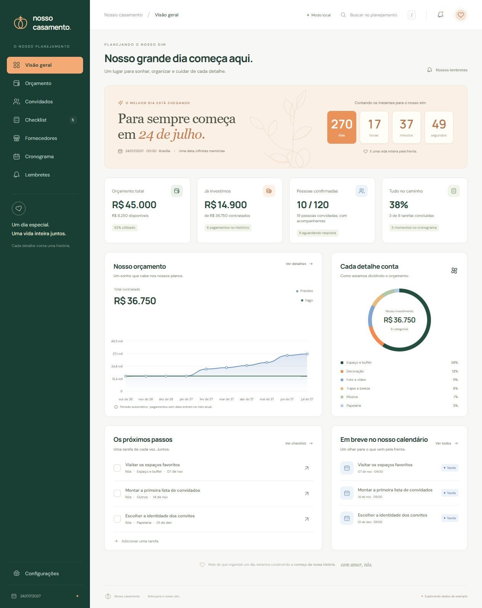
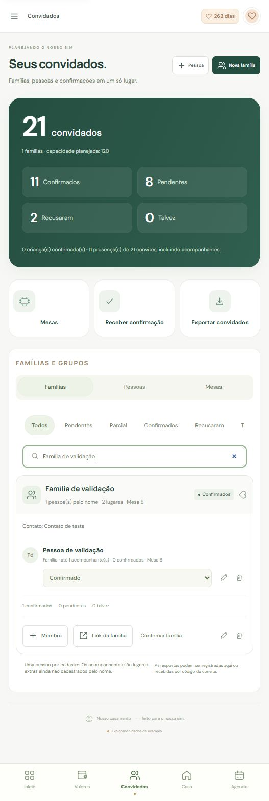

# Nosso Casamento 💍

**Cada detalhe, mais perto do sim.** Aplicativo para organizar o casamento, com contagem regressiva inicial para **24/07/2027**, orçamento, convidados e uma agenda do grande dia. A interface usa **laranja, branco, azul e verde**, em português e com layout para celular e computador.



## Android e acesso local

**[Baixar NossoCasamento-2.1.0.apk](https://github.com/PedroHda/NossoCasamento/raw/refs/heads/master/apk/NossoCasamento-2.1.0.apk)** · [SHA-256](apk/NossoCasamento-2.1.0.apk.sha256) · [Guia de instalação e compilação](docs/android.md)

O APK inclui a interface e as fontes, funciona sem internet e usa assinatura de debug para instalação direta. Requer Android 7.0+ e WebView/Chrome 110+. Não foi testado em aparelho físico nesta atualização.

**Atualização da v2.0.0:** a chave disponível neste computador é diferente da usada no APK 2.0.0 do repositório. Exporte o backup no app antigo antes de desinstalar; instale a 2.1.0 e importe o JSON. A instalação por cima depende da chave anterior. Nunca apague os dados antes de preservar o backup.

```bash
git clone https://github.com/PedroHda/NossoCasamento.git
cd NossoCasamento
npm ci
npm run dev
```

Abra o endereço mostrado pelo terminal, normalmente **http://127.0.0.1:5173/**. É necessário **Node.js 22.12+**. Não é preciso banco de dados, chave de API, conta ou arquivo `.env`.

## Novidades da versão 2.1.0

- **Convidados:** famílias vinculadas a pessoas, contato do núcleo, mesa, crianças, acompanhantes, confirmação individual e em grupo, status Talvez, filtros de resposta parcial e visão por mesas. Os cadastros anteriores continuam disponíveis como convites individuais.
- **Nossa casa:** aba dentro de Valores com itens por cômodo/categoria, quantidades desejadas e recebidas, prioridade, preço unitário estimado, loja, produto e entrega. A estimativa do que falta fica separada das despesas do casamento. Exportação CSV na própria tela.
- **Agenda Android:** conexão opcional com um calendário editável do celular. Após autorizar, o app cria e atualiza cópias dos próximos compromissos, tarefas, pagamentos e entregas. No navegador, há exportação ICS e links para preparar eventos no Google Agenda.
- **Navegação:** atalhos inferiores no celular e contagem regressiva no cabeçalho das áreas do planejamento.



Veja [sugestões para as próximas versões](docs/proximas-funcionalidades.md); elas ainda não foram implementadas.

## O que está implementado

| Área          | Recursos                                                                                                         |
| ------------- | ---------------------------------------------------------------------------------------------------------------- |
| Visão geral   | Contagem em tempo real, resumo financeiro, confirmações, progresso, gráficos e próximos prazos.                  |
| Orçamento     | Estimado versus contratado, vínculo com fornecedor, histórico de pagamentos, saldo e vencimento.                 |
| Parcelas      | Divisão do saldo em até 36 parcelas mensais, centavos distribuídos corretamente e pagamento vinculado à parcela. |
| Comprovantes  | PDF, PNG e JPG guardados localmente, com download e inclusão no backup.                                          |
| Convidados    | Famílias, pessoas, mesas, crianças, status Talvez, acompanhantes e restrições alimentares.                       |
| Convites      | Link individual ou familiar, resposta por pessoa e código para importação manual pelo casal.                     |
| Nossa casa    | Inventário por cômodo, já temos/falta, estimativas, prioridades, compras, entregas e CSV.                        |
| Checklist     | Prazo, responsável, prioridade, conclusão e filtros.                                                             |
| Fornecedores  | Contato, proposta de preço, etapa da negociação, comparação por categoria/valor e criação de despesa vinculada.  |
| Cronograma    | Momentos com data, horário, duração, local, antecedência própria e link do Google Agenda.                        |
| Lembretes     | Tarefas, pagamentos, cronograma e entregas; ICS, notificações e conexão opcional à agenda Android.               |
| Relatórios    | PDF do planejamento, CSV de orçamento/convidados e agenda ICS.                                                   |
| Configurações | Casal, data, horário, orçamento, meta, local e endereço público dos convites.                                    |
| Recuperação   | Backup JSON, migração da versão 1, lixeira e botão de desfazer a alteração mais recente.                         |

A interface inclui busca global pelo botão ou atalho `/`, filtros, formulários validados, navegação por teclado e foco visível. As janelas usam `<dialog>` e o layout respeita a preferência de movimento reduzido.

## Começar a usar

1. Explore os **dados de exemplo**, que são fictícios.
2. Em **Configurações**, personalize o casal, a data, o horário, o local e as metas.
3. Use **Começar do zero** para remover exemplos e lixeira, preservando as preferências. Exporte uma cópia antes se já fez alterações.
4. Cadastre fornecedores e despesas; abra **Pagamentos e parcelas** na despesa para registrar o histórico.
5. Adicione convidados, tarefas e momentos ao cronograma.
6. Exporte backups regularmente e antes de substituir o planejamento.

Editar um exemplo não remove automaticamente o indicador de demonstração. Começar do zero cria o planejamento sem exemplos.

## Data e regras de cálculo

A data inicial é **24/07/2027 às 00:00**, mas pode ser alterada nas configurações, sem editar código. A contagem usa o horário de Brasília com offset **UTC−03:00**, atualiza a cada segundo e fica em zero ao chegar ao instante escolhido. O relógio do aparelho precisa estar correto. Os momentos do cronograma têm datas próprias e não são deslocados quando a data do casamento muda.

- **Contratado:** soma dos valores das despesas; **estimado:** soma das estimativas.
- **Pago:** soma do histórico; **falta pagar:** contratado menos pago.
- **Disponível:** orçamento menos contratado. Valor negativo indica estouro.
- Valores são somados em centavos. Um pagamento não pode ultrapassar o total da despesa ou o saldo da parcela escolhida.
- As parcelas dividem o saldo após os pagamentos avulsos. Vencimentos respeitam o último dia do mês: 31/01 → 28/02 → 31/03, por exemplo.
- Depois de registrar pagamentos vinculados, o parcelamento é preservado. Para refazê-lo, remova esses pagamentos conscientemente ou ajuste o cadastro.
- O gráfico considera pagamentos nas datas registradas e saldos nos vencimentos, sem duplicar parcelas. O período se adapta aos dados, inclusive depois do casamento, com até 12 pontos mensais acumulados.
- Saldos migrados da versão 1 não possuem data histórica: são identificados como importados e entram no mês atual do gráfico.
- Confirmados somam a pessoa principal e os acompanhantes efetivamente confirmados. Quando essa quantidade ainda não foi informada, usam o limite do convite, preservando os dados antigos.
- Tarefas concluídas saem dos lembretes; parcelas pagas também. Prazos vencidos permanecem visíveis enquanto pendentes.

## Convites sem servidor

O fluxo de confirmação desta versão é **manual**, pois não há banco ou backend:

1. Cadastre uma família e vincule seus membros, ou mantenha o convite individual. Cada pessoa deve ter um cadastro; acompanhantes são lugares extras ainda sem nome, evitando contagem duplicada.
2. Para enviar um link a outro aparelho, publique o site em uma hospedagem estática e configure seu endereço HTTPS em **Configurações**. `localhost` só abre no próprio aparelho; nessa situação o botão de copiar para enviar fica desativado, mas o teste do convite funciona.
3. Abra **Link da família** ou o convite individual e copie o link para enviá-lo pelo canal de sua preferência. O atalho WhatsApp apenas prepara a mensagem.
4. O convidado preenche presença, acompanhantes e restrições de cada pessoa, e envia ao casal o código gerado. Uma família pode ter respostas diferentes entre membros.
5. Em **Convidados → Receber confirmação**, cole o código, confira e aplique. Respostas com membros desconhecidos, acompanhantes acima do limite ou anteriores à última resposta importada são rejeitadas.

O formulário não envia a resposta automaticamente. O link contém somente os dados daquele convite individual ou núcleo familiar, sem contatos, orçamento ou restante da lista. O código identifica o convite, mas **não autentica a identidade da pessoa**. Compartilhe os links com cuidado. Convites familiares aceitam até 80 pessoas e têm limite de tamanho. Não há envio automático de mensagens nem publicação de site habilitada pelo push.

## Agenda e avisos

No APK, abra **Agenda** ou **Lembretes → Conectar agenda**, conceda a permissão de calendário, escolha a agenda e toque em **Autorizar conexão automática**. São mantidas até 250 cópias dos próximos eventos e do dia anterior, sem convidar participantes. O calendário escolhido pode sincronizar com a conta Google ou outra conta já configurada no aparelho; se for compartilhado, quem tem acesso verá os eventos.

A conexão é atualizada ao abrir/retomar o app e após alterações. Eventos do cronograma podem ter duração e antecedência próprias. Tarefas, pagamentos e entregas usam 09:00 de Brasília e a antecedência geral. Itens concluídos/pagos/recebidos deixam de gerar cópias futuras; eventos pessoais são preservados. Desconectar remove as cópias reconhecidas como pertencentes ao app. A autorização é por aparelho; importar um backup pode exigir reautorizar a agenda.

No navegador, **Baixar agenda** produz um ICS com alarmes; a importação é manual e repetida importação pode depender de como seu calendário trata os IDs. O link Google Agenda prepara um evento para você revisar e salvar. O app não mantém conexão automática do navegador com o Google.

## Dados locais e backups

**Nenhum banco de dados foi implementado.** A única persistência é o `localStorage`, na chave `nosso-casamento:v2`. Não há login, colaboração ou sincronização entre celulares. Código, APK e documentação vão para o Git; os cadastros não são enviados pelo aplicativo ao repositório ou a um servidor.

O armazenamento pertence ao navegador/perfil/origem (protocolo, endereço e porta). O APK tem seu próprio armazenamento. Trocar de endereço ou aparelho não transfere os dados. Limpar dados, desinstalar ou usar modo privado pode apagá-los.

### Migração e conflitos

- O primeiro acesso à versão 2 migra a chave `nosso-casamento:v1` quando ainda não existe uma versão 2.
- A chave antiga é mantida intacta para recuperação; alterações novas são gravadas somente na versão 2.
- IDs, nomes, valores pagos e confirmações antigos são preservados. Datas desconhecidas de pagamentos não são inventadas.
- A versão 2.1 mantém o schema v2 e completa os campos novos com valores padrão: famílias e lista da casa vazias, sem inferir parentesco nem conectar calendários automaticamente.
- Abas da mesma origem recebem atualizações. Revisões e Web Locks, quando disponíveis, impedem a gravação silenciosa sobre alterações mais recentes. Sem Web Locks, a proteção é limitada à verificação de revisão.
- Dados inválidos não são trocados automaticamente por exemplos: uma tela de recuperação oferece exportação bruta e importação.

### Exportar e restaurar

Em **Configurações**, exporte o JSON e guarde uma cópia fora do aplicativo. Ele inclui preferências, registros, pagamentos, comprovantes e lixeira, **sem criptografia**. Para restaurar, importe um backup v1 ou v2 de até **6 MB** e confirme a substituição. A importação substitui o planejamento inteiro; não mescla registros.

São validados versões, datas, valores, referências e IDs. Cada lista aceita até 10.000 registros; a lixeira aceita 100. Quando estiver cheia, exporte um backup e esvazie-a para continuar excluindo registros. Desfazer fica disponível por 12 segundos e apenas enquanto não houver alteração posterior; a lixeira permite recuperar cadastros depois disso.

### Limites dos comprovantes

PDF, PNG e JPG de até **500 KB por arquivo**, até **10 por despesa** e **1,5 MB de arquivos no planejamento inteiro**, incluindo a lixeira. O conteúdo e a assinatura básica do formato são conferidos. O navegador pode atingir sua própria cota antes desses limites, dependendo dos outros dados; uma falha de gravação preserva a versão anterior. O PDF do relatório não incorpora os comprovantes; use o backup para transportá-los.

## Preparado para um banco futuro

A interface usa o contrato assíncrono `PlanningRepository`; hoje ele é implementado por `LocalPlanningRepository`. A escolha do adaptador está em `src/data/services.ts`. O `PlanningProvider` também recebe serviços por injeção, permitindo substituir o repositório sem reescrever as telas.

Existem contratos para sessão (`IdentityGateway`) e convite de membros (`CollaborationGateway`), ainda sem implementação. O modelo tem IDs, versão de schema, revisão e timestamps para apoiar uma futura API. **Não foram adicionados SDK de banco, credenciais, tabelas remotas ou login fictício.**

Veja [arquitetura e integração futura](docs/architecture.md) para os limites atuais e os passos necessários antes de habilitar colaboração.

## Stack e estrutura

- **React 19 + TypeScript** para componentes, estado e contratos.
- **Vite 7**, CSS responsivo, SVG e fontes locais DM Sans/Manrope.
- **Zod 4** para validar cadastros e backups.
- **jsPDF + AutoTable** para relatório PDF; CSV e ICS gerados localmente.
- **Capacitor 8** com plugins de arquivos, compartilhamento, eventos do aplicativo e notificações locais.
- **Node.js Test Runner**, sem servidor de testes externo.

```text
src/
├── app/                 # Navegação React e estado com repositório injetável
├── components/          # Formulários, janelas, pagamentos e convites
├── data/                # Contratos e adaptador local
├── domain/              # Schema v2, migração e regras de planejamento
├── services/            # Arquivos, PDF/CSV/ICS, convites e notificações
├── views/               # Telas do aplicativo
├── main.tsx             # Entrada React e convite público
├── model.js             # Modelo legado para migração v1
├── icons.js             # Ícones e marca SVG
├── style.css            # Identidade visual e layout original
└── improvements.css     # Layouts e componentes da versão 2
android/                 # Projeto nativo e Gradle wrapper
apk/                     # APKs de demonstração e checksums
scripts/build-android.mjs
tests/                  # Regras, migração, armazenamento e exportações
```

Cores principais: verde `#193e33`/`#244e40`, laranja `#eb8952`, branco `#ffffff`, azul `#799fcf` e fundo `#f7f8f5`.

## Comandos e verificações

| Comando                | Finalidade                                              |
| ---------------------- | ------------------------------------------------------- |
| `npm ci`               | Instalar as versões do lockfile.                        |
| `npm run dev`          | Abrir servidor local com atualização automática.        |
| `npm run typecheck`    | Conferir os tipos TypeScript.                           |
| `npm test`             | Executar 33 testes de regras, migração e armazenamento. |
| `npm run build`        | Conferir tipos e gerar `dist/`.                         |
| `npm run preview`      | Servir o build localmente.                              |
| `npm run android:sync` | Gerar build web e sincronizar com Android.              |
| `npm run android:apk`  | Compilar APK debug e checksum em `releases/`.           |
| `npm run android:open` | Abrir o projeto no Android Studio.                      |

```bash
npm test
npm run build
npm run android:apk
```

O APK requer **JDK 21, SDK Android 36** e acesso à internet para baixar dependências na primeira compilação. O script detecta instalações usuais; use `JAVA_HOME` e `ANDROID_HOME` se necessário. Não há chaves de assinatura release no repositório.

## Publicação web

Publique o conteúdo de **`dist/`** em uma hospedagem estática. Comando de build: `npm run build`; saída: `dist`. Os caminhos relativos (`base: './'`) permitem subpastas, e a navegação por hash dispensa regras de reescrita.

Um servidor local de desenvolvimento precisa ser iniciado pelo terminal; ele não se torna público com o push. A versão web não instala service worker nesta etapa: o APK funciona offline por incorporar os arquivos; reabrir o site web offline depende do cache do navegador.

## Limitações e próximos passos

- Login do casal, sincronização, armazenamento remoto de arquivos e RSVP automático aguardam um backend.
- Notificações do aparelho estão no APK e precisam de permissão. São agendados até 50 próximos avisos futuros; ao abrir ou alterar o planejamento a agenda é atualizada. O horário depende das restrições e permissões do Android.
- A data usa o offset atual de Brasília, UTC−3; não há tabela histórica de horário de verão.
- Não há integração bancária, cobrança, envio automático de convites ou publicação configurada.
- Assinatura release, testes em dispositivos e publicação em loja ainda precisam ser feitos para distribuição definitiva.

## Contribuição

Preserve a paleta, o português e a compatibilidade com backups existentes. Antes de propor mudanças, execute `npm test` e `npm run build`. Alterações de schema precisam de migração e validação. `node_modules`, builds, `.env`, dados pessoais, caches e chaves não são versionados. O repositório ainda não define uma licença de distribuição.
